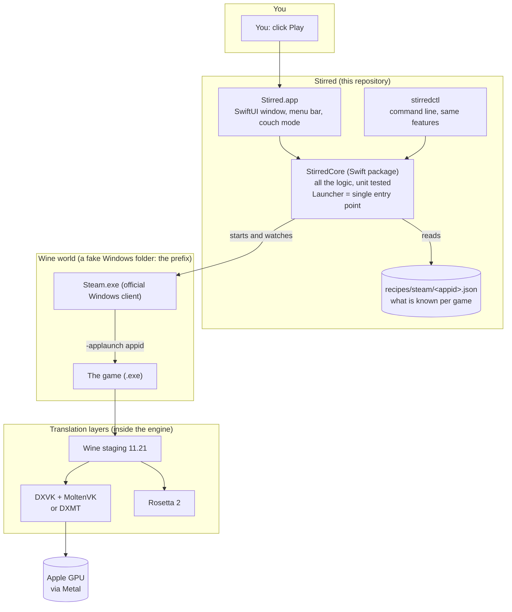
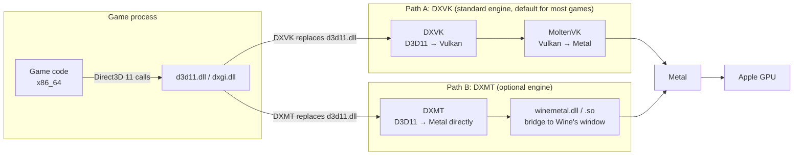
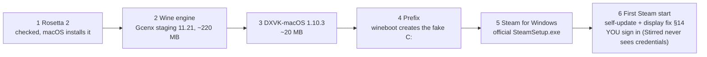
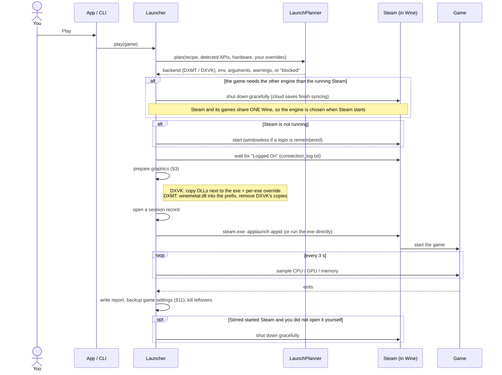
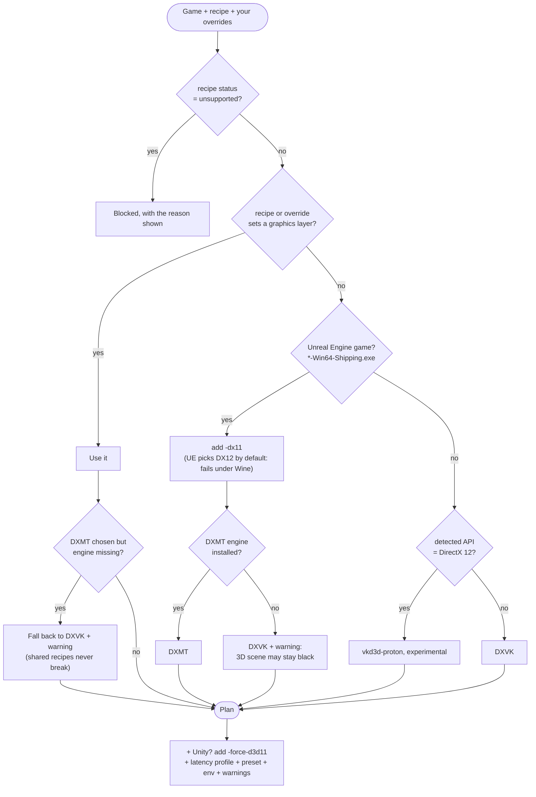

# How Stirred works

This is the complete guide: what each piece is, why it exists, how a click on **Play** becomes pixels on your screen, and where to look when
something breaks. The diagrams are [Mermaid](https://mermaid.js.org) and render on GitHub.

- [1. The idea in one minute](#1-the-idea-in-one-minute)
- [2. The big picture](#2-the-big-picture)
- [3. From a DirectX call to a pixel (the graphics stack)](#3-from-a-directx-call-to-a-pixel-the-graphics-stack)
- [4. Where everything lives on disk](#4-where-everything-lives-on-disk)
- [5. First run: the setup](#5-first-run-the-setup)
- [6. What happens when you press Play](#6-what-happens-when-you-press-play)
- [7. The planner: choosing how to run a game](#7-the-planner-choosing-how-to-run-a-game)
- [8. Engines: the standard one and the DXMT one](#8-engines-the-standard-one-and-the-dxmt-one)
- [9. Recipes, personal settings, presets](#9-recipes-personal-settings-presets)
- [10. Diagnosis: "It doesn't work"](#10-diagnosis-it-doesnt-work)
- [11. Safety nets](#11-safety-nets)
- [12. The library: what you own, what runs, pictures](#12-the-library-what-you-own-what-runs-pictures)
- [13. The app: screens and modes](#13-the-app-screens-and-modes)
- [14. The Steam display fix](#14-the-steam-display-fix)
- [15. Code map](#15-code-map)
- [16. Building, testing, debugging](#16-building-testing-debugging)
- [17. Glossary](#17-glossary)
- [18. "Where do I look when…"](#18-where-do-i-look-when)
- [19. Limits and rules](#19-limits-and-rules)

---

## 1. The idea in one minute

Your Mac runs macOS on an Apple chip (arm64). Windows games are built for Windows on Intel/AMD chips (x86_64) and speak DirectX, a Windows-only
graphics language. Three translations are needed:

| Problem | Translator | Plain words |
|---|---|---|
| Windows programs call Windows functions | **Wine** | A re-implementation of Windows' functions on top of macOS. No Windows is installed. |
| The game's code is for Intel/AMD chips | **Rosetta 2** (Apple) | Translates x86_64 instructions to arm64 on the fly. |
| The game draws with DirectX | **DXVK + MoltenVK**, or **DXMT** | Translate DirectX drawing commands into Metal, the language of the Mac's GPU. |

Stirred does not translate anything itself. It is the **conductor**: it installs and wires these pieces, runs the official Windows Steam client
inside Wine, picks the right way to run each game, watches the game while it runs, and fixes or reports problems. You click **Play**; Stirred
does everything else.

Not in the stack, on purpose: Apple's Game Porting Toolkit / D3DMetal (restrictive licence), and any anti-cheat or DRM bypass.

## 2. The big picture



**One rule makes the code simple:** the app and the CLI contain no logic. Everything goes through `Launcher` in `StirredCore`, so what you can
do in the window you can also script, and every rule is covered by unit tests without opening a window.

## 3. From a DirectX call to a pixel (the graphics stack)

When a game draws a frame it calls Direct3D 11. Two different paths turn this into Metal:



Why two paths? Path A is mature and works for most DirectX 9/10/11 games, but Vulkan on Metal (MoltenVK) lacks two things some Unreal and
some Unity games need: **geometry shaders** and **typed storage-image formats**. Result: the interface draws but the 3D scene stays **black**
(RV There Yet?, Orcs Must Die 3). Path B (DXMT, LGPL) talks to Metal directly and supports them, but it needs a Wine whose Mac driver exposes a
few internal functions (§8), so it ships as a separate, optional engine.

CPU side, independently: Wine on Apple Silicon runs **x86_64** (Intel code) under **Rosetta 2**. Apple has announced Rosetta's phase-out after
macOS 27; that is the biggest long-term risk (see ROADMAP).

DirectX 12 games go to **vkd3d-proton** (DX12 → Vulkan) in theory; it is not installed, so Stirred prefers forcing DirectX 11 (`-dx11`) when a game allows it.

## 4. Where everything lives on disk

Default root: `~/Library/Application Support/Stirred` (override with the `STIRRED_ROOT` environment variable; tests and experiments use this).

```
Stirred/
├── engines/
│   ├── stirred-wine-11.21/          the standard engine (Wine + Rosetta path)
│   ├── stirred-wine-11.21-dxmt/     OPTIONAL engine with DXMT (never picked by default)
│   ├── active.txt                   engine chosen by an update / rollback
│   └── steam-engine.txt             engine the running Steam was started with (removed when Steam stops)
├── components/dxvk-macos-1.10.3/    DXVK DLLs (x32/ x64/)
├── prefixes/
│   ├── steam/                       THE fake Windows: C: drive, registry, Steam, all games
│   │   └── drive_c/Program Files (x86)/Steam/steamapps/{common, appmanifest_*.acf}
│   └── snapshots/<engine>/          registry + Windows system files saved before an engine switch
├── backups/<date>-<reason>/         copies of game settings, controls and saves (§11)
├── overrides/steam/<appid>.json     your personal settings per game (§9)
├── recipes/steam/<appid>.json       recipes you imported (win over the bundled ones)
├── cache/store/                     Steam store answers kept 30 days
├── downloads/                       downloaded archives, verified by SHA-256
└── logs/
    ├── steam-client.log             (rotated at 20 MB)
    ├── game-<appid>.log
    └── sessions/<date>-<appid>/     session.json, report.md, redacted logs
```

Key idea: **settings and saves live in the prefix** (`prefixes/steam/drive_c/users/<you>/AppData/...`), not in the engine. Changing engine never
touches them. Deleting the prefix would, which is why §11 exists.

## 5. First run: the setup

`SetupManager` runs six idempotent steps (each checks if it is already done, so it can be interrupted and resumed). Downloads are pinned by SHA-256.



Stirred never types or stores a password or token. The sign-in happens in Steam's own window.

## 6. What happens when you press Play



Details that matter:

- **Why DXVK DLLs sit next to each game's exe** and are enabled per executable (`HKCU\Software\Wine\AppDefaults\<exe>\DllOverrides`): Steam is
  already running when the game starts, so per-game environment variables never reach it, and a global override would also affect Steam itself.
- **Launch modes**: `steam` asks Steam (`-applaunch`: overlay, cloud saves, DRM checks work); `direct` runs the exe itself with `SteamAppId` set
  (Steam stays running for Steamworks). Some games need `direct` to skip a broken launcher.
- **Orphan reaper**: whenever Steam is stopped, leftover Wine/steamwebhelper processes are killed so a stuck one never blocks the next start.
- **Clean-up** uses `steam.exe -shutdown` first so Steam can finish syncing cloud saves and playtime, then kills what is left.

## 7. The planner: choosing how to run a game

`LaunchPlanner` is a **pure function** (inputs in, plan out), which is why it is easy to test. `Launcher.plan(for:)` adds the facts only the
disk knows (Unreal? Unity? is the DXMT engine installed?).



Graphics detection (`GraphicsDetector`) is a cheap heuristic: it looks for DLL names (`d3d11.dll`, `d3d12.dll`, `vulkan-1.dll`...) in the exe's bytes.
A hint, never a promise; recipes override it.

**Latency profiles** (`balanced`, `low`, `lowest`) become `dxvk.conf` lines: frames queued ahead (each adds ~16 ms at 60 Hz), V-Sync forced
off for `lowest`.

## 8. Engines: the standard one and the DXMT one

**Standard engine** = Gcenx's build of Wine staging 11.21, downloaded as-is.

**DXMT engine** = a copy of the standard engine with:

1. a rebuilt `winemac.so` (Wine's macOS driver), built from Wine 11.21 + Wine Staging 11.21 sources by `Scripts/build-dxmt-engine.sh`;
2. DXMT v0.80 (`d3d11`, `d3d10core`, `dxgi`, `winemetal` DLLs and `winemetal.so`).

Why a rebuild? DXMT looks up Wine internals with `dlsym("macdrv_functions")` and expects a CrossOver-style window-data layout. Upstream Wine
hides all `macdrv_*` symbols and uses another layout. Our patches (`Patches/dxmt/`):

| Patch | What it fixes |
|---|---|
| `window_dxmt.c.inc` | exports a `macdrv_functions` table and a compatibility layer presenting Wine's window data in DXMT's layout; creates the Metal view on demand, **unhidden** (Wine creates views hidden: without this the window stayed uniformly grey) |
| (build script) | exports the five Metal entry points from `macdrv_cocoa.h` |
| `cursor-stay-hidden.patch` | a cursor the game hid is no longer brought back when no Wine window is under the pointer |

**Who uses which engine, and when it is chosen.** Steam and every game it launches share one Wine process tree, so the engine is fixed **when
Steam starts**. `engines/steam-engine.txt` remembers it. When you press Play on a DXMT game while Steam runs on the standard engine (or the
reverse), Stirred closes Steam gracefully and restarts it under the right engine. The standard engine never changes by itself; the DXMT one is
never the default and is invisible to engine updates.

**Engine updates** (`EngineUpdater`, `Resources/engines.json`): only pinned, tested builds. Install = download, verify SHA-256, take a **prefix snapshot**
(registry + Windows system files, copied with APFS cloning in a blink), switch, run a smoke test (`cmd /c echo stirred-ok`); **rollback** restores the snapshot.
A new Wine rewrites the registry the first time it runs, which is why the old engine could not simply be re-selected without the snapshot.

## 9. Recipes, personal settings, presets

A **recipe** is what is known about one game, a small JSON file in `recipes/steam/<appid>.json`:

```json
{ "appid": 3949040, "name": "RV There Yet?", "status": "experimental", "verified": false,
  "graphics": "dxmt", "latency": "low", "launch_args": ["-dx11"], "notes": "..." }
```

Fields: `status` (perfect · playable · experimental · offline-only · unsupported), `blockers`, `graphics`, `env`, `dll_overrides`, `launch_args`,
`launch_mode`, `latency`, `dxvk_options`, `preset`, `updater` (a game's own launcher to run through Steam, e.g. Warframe), `notes`, `verified`.

**Who wins** (strongest first):

| Setting | Order |
|---|---|
| Latency | this run's option > your personal setting > preset > recipe > default (`low`) |
| `dxvk.conf` options | personal > recipe > preset |
| Everything else | personal override (`overrides/steam/<appid>.json`) merged over the recipe |
| Recipe lookup | imported recipe (`<root>/recipes`) before the bundled one |

**Presets** (Faster / Balanced / Prettier) only use levers Stirred really controls: frame queue, V-Sync, background shader compilation, frame cap.
They never change a game's own graphics options.

**Community recipes**: export a recipe as a file, import one someone shared. Imports are validated (only graphics settings, launch arguments, harmless
variables; never marked `verified`) and win over the bundled one. See [COMMUNITY-RECIPES.md](COMMUNITY-RECIPES.md).

## 10. Diagnosis: "It doesn't work"

`Diagnoser.diagnose` is a pure function over a `DiagnosisInput` (setup state, plan, power, disk, the game's log text, the last session, whether DXVK is
next to the exe, Unity / 32-bit facts, stale processes). Each rule yields a `Diagnosis` (blocker, problem, advice) with a one-click `DiagnosisFix`:
reinstall the graphics layer, add a launch argument, switch launch mode, kill stale processes... Settings fixes are saved as personal overrides, so
they survive Stirred updates and never touch the bundled recipes. A session counts as "never started" only when the sampler really waited for the process.

## 11. Safety nets

| Net | What it protects | How |
|---|---|---|
| **Game data backup** (`Backup.swift`) | game settings, controls, saves, Steam `userdata` | APFS-cloned copies in `backups/`, after each game (5 kept, skipped when nothing changed) and before engine switch / rollback / uninstall / move (10 kept each). Restore in Disk > "Game settings and saves", or `stirredctl backup restore <name>`; a safety copy is taken first. Same disk only: it protects against mistakes, not a dead disk |
| **Prefix snapshot** | the Windows registry and system files | taken before an engine switch, restored on rollback |
| **Uninstall guardrails** | your files | the folder must resolve to exactly one level under `steamapps/common`; app id numeric; a running game blocks it; the manifest is deleted last |
| **Disk mover** | big games | moves a game to another disk and leaves a symlink in `steamapps/common`; Steam still sees it; plug the disk in before playing |
| **Orphan reaper** | stuck processes | kills leftover Wine helpers whenever Steam is stopped |
| **Log redaction** | your privacy | your name and home path are removed from every stored report |
| **Fallbacks** | shared recipes | DXMT without its engine falls back to DXVK with a warning |

Every destructive operation first closes Steam gracefully so Steam does not write to files that are being changed.

## 12. The library: what you own, what runs, pictures

- **Library** shows the games installed in the prefix (read from `appmanifest_*.acf`), with a status badge from the recipe.
- **All my games** ranks your whole Steam library by how likely each game is to run, **offline**: `SteamLocalData` reads two of Steam's own binary
  cache files (`appcache/packageinfo.vdf` = which apps you own, `appcache/appinfo.vdf` = name, platforms, Steam Deck status). Every read is
  bounds-checked; a format change raises a clear error instead of crashing. `LibraryAnalysis.refine` then asks the store about the games where an answer
  could still change the verdict, most promising first, one request every 1.6 s (Steam allows ~200 per 5 min; HTTP 429 waits a minute), kept 30 days.
- **Check a game**: paste an app id or a store link (or type a name) and get a verdict before installing.
- **Pictures** (`Covers.swift`, `GameCover`): Steam's own downloaded copy in `appcache/librarycache/<id>/` first (works offline, and for new games
  whose public address answers 404), then public addresses (Cloudflare, Akamai, capsule), then the store's `header_image`, then a generated coloured
  tile with the game's name. Loaded images are kept for the session.

## 13. The app: screens and modes

| Screen | Purpose |
|---|---|
| Library | cards, Play / Stop, preset picker, card-size slider (or pinch) |
| All my games | whole owned library, ranked; Install |
| Check a game | verdict for any app id or link |
| Disk | space, cleanup, move games, game-data backups |
| Engine | installed engines, tested updates, rollback |
| Activity | running games, live CPU / GPU |
| Logs | Steam and game logs |

Also: **menu-bar icon** (what runs, play/stop, close Steam), **couch mode** (full-screen big covers, keyboard or controller via GameController),
**zoom** ⌘+ / ⌘− / ⌘0 (scales text and pictures, not the whole view: scaling a whole view broke clicks inside scroll views),
**Close Steam after playing**, **FPS overlay** (Metal HUD / DXVK HUD), power warnings (battery, Low Power Mode cap performance).

## 14. The Steam display fix

Under Wine 11 the Chromium behind Steam's UI paints a black window. `steamwebhelper.exe` is replaced by a tiny wrapper
(`Wrapper/steamwebhelper_wrapper.c`, compiled copy in `Resources/wrappers/`) that starts the original, saved as `steamwebhelper_real.exe`, with
`--disable-gpu --single-process`. Steam is started with `-noverifyfiles -nobootstrapupdate` so it does not restore the original.
`WebHelperWrapper` tells the two apart **by file size, never by hash** (a hash comparison once made the wrapper copy itself over the real helper and
launch itself forever; a test covers it). Rebuild with `Scripts/build-wrappers.sh` (needs `brew install mingw-w64`), only when the C file changes.

## 15. Code map

```
Sources/
├── StirredCore/          all logic (no UI)
│   ├── Launcher.swift         single entry point: engine choice, play, Steam start/quit, plan, graphics prep, reaper
│   ├── Setup.swift            first-run installer (6 steps, SHA-256 pinned)
│   ├── Engine.swift           engine lookup (standard vs -dxmt), versions
│   ├── EngineUpdate.swift     catalog, install, switch, snapshot, rollback, smoke test
│   ├── LaunchPlanner.swift    pure plan function
│   ├── Recipe.swift           recipes, repository, updater
│   ├── Overrides.swift        personal per-game settings
│   ├── Presets.swift          Faster / Balanced / Prettier
│   ├── Community.swift        recipe export / import with validation
│   ├── GraphicsSetup.swift    PE architecture, DXVK install, dxvk.conf
│   ├── GraphicsDetection.swift  which DirectX does an exe import
│   ├── Steam.swift            Steam client flags, library from .acf, launch modes
│   ├── SteamLocalData.swift   Steam's binary cache files (offline)
│   ├── LibraryAnalysis.swift  ranking + store refinement + cache
│   ├── Store.swift            store API client, verdicts
│   ├── Covers.swift           where a game's picture comes from
│   ├── Diagnosis.swift        rules and fixes
│   ├── SessionReport.swift    sampling, logs, redaction, report.md
│   ├── Backup.swift           game-data backups
│   ├── DiskManagement.swift   disk usage, cleanup, move games
│   ├── Uninstall.swift        safe uninstall
│   ├── WebHelperWrapper.swift Steam display fix
│   ├── WineRunner.swift       builds Wine processes (WINEPREFIX, env)
│   ├── CouchNavigation.swift  controller / keyboard navigation logic
│   └── PowerState.swift, LogRotation.swift, VDF.swift, Paths.swift
├── StirredApp/           SwiftUI: Views, AppModel (state), Couch, GameCover, StirredApp (scenes, menu bar, zoom commands)
└── stirredctl/           CLI over Launcher
recipes/steam/            bundled recipes          Wrapper/          steamwebhelper wrapper (C)
Patches/dxmt/             Wine patches for DXMT    Scripts/          build app, DXMT engine, wrappers, dmg
Resources/engines.json    tested engine catalog    Tests/            unit tests (Swift Testing) + Integration/d3d11_clear.c
```

## 16. Building, testing, debugging

```bash
swift build                      # library + CLI + app
sh Scripts/build-app.sh          # build/Stirred.app (ad-hoc signed, not notarized)
swift test                       # unit tests (each rule is a pure function)
sh Scripts/build-dxmt-engine.sh  # optional DXMT engine, ~15 min of compiling
```

Handy: `stirredctl run <game> --watch --hud` (sample while you play), `stirredctl diagnose <game> --fix`, `stirredctl report`,
`stirredctl backup list`, `STIRRED_ROOT=/tmp/x` for a throw-away data folder, `open build/Stirred.app --args -section logs`.
Kill Wine with `wineserver -k` (or Stirred's Quit), not `kill -9`. Per-window captures of Metal windows are black: judge 3D rendering by eye.

## 17. Glossary

| Word | Meaning |
|---|---|
| **Wine** | Re-implementation of Windows' functions for macOS/Linux. Runs Windows programs without Windows. |
| **Prefix** | A folder that Wine treats as `C:\`: registry, system files, Steam, games, saves. |
| **Engine** | One build of Wine (plus graphics layers) in `engines/`. |
| **Rosetta 2** | Apple's Intel-to-Apple-chip translator, runs the game's x86_64 code. |
| **DirectX / Direct3D 11** | Windows' graphics API; what most games speak. |
| **Vulkan / Metal** | Graphics APIs of "everyone" / of Apple. The GPU only understands Metal here. |
| **DXVK** | Translates Direct3D 9/10/11 → Vulkan. |
| **MoltenVK** | Translates Vulkan → Metal. |
| **DXMT** | Translates Direct3D 11 → Metal directly. Needs the DXMT engine. |
| **vkd3d-proton** | Translates Direct3D 12 → Vulkan. Experimental, not installed by default. |
| **Geometry shader** | A GPU stage some engines use; absent from Metal, handled by DXMT but not through MoltenVK. |
| **Recipe** | What is known about one game (JSON). |
| **Override** | Your personal per-game setting, merged over the recipe. |
| **Session** | One recorded run of a game (samples, logs, report). |
| **APFS clone** | An instant copy that shares disk blocks until a file changes. Used for snapshots and backups. |
| **Steam appid** | A game's number on Steam (e.g. 3949040 = RV There Yet?). |
| **EOS** | Epic Online Services, used by some Unreal games for multiplayer. |

## 18. "Where do I look when…"

| Symptom | Look at |
|---|---|
| Play does nothing | the red banner in Library; `stirredctl run <game>` shows the same error in a terminal; `logs/sessions/latest` |
| Steam window black | §14; `logs/steam-client.log` |
| Game starts then closes | `logs/game-<appid>.log`, the game's own log (e.g. `prefixes/steam/drive_c/users/<you>/AppData/Local/<Game>/Saved/Logs`), `stirredctl diagnose <game>` |
| 3D scene black, UI fine | §3: MoltenVK limits; try the DXMT engine (`"graphics": "dxmt"`) |
| "D3D11-compatible GPU required" | the game chose DX12; add `-dx11` (Unreal games get it automatically) |
| Grey game window with DXMT | the Metal view is hidden: `window_dxmt.c.inc` must unhide it |
| Lost a setting or a save | `stirredctl backup list`, then `restore` |
| Wrong engine after switching games | `engines/steam-engine.txt`; Stirred restarts Steam by itself, or use Quit then Play |
| Missing picture | `Covers.swift` chain; Steam's `appcache/librarycache/<id>` |
| Multiplayer lobby fails | game log with `LogOnline` verbose (Engine.ini `[Core.Log]`), `connection_log.txt` |

## 19. Limits and rules

- Apple Silicon only. Needs Rosetta 2. Free and open source (GPL-3); ad-hoc signed, not notarized (no paid Apple account).
- Never: D3DMetal / GPTK, anti-cheat or DRM bypass, handling your Steam credentials. Games protected by kernel anti-cheat (EAC, BattlEye, Vanguard)
  are marked unsupported or offline-only with the reason shown.
- Honest limits: DirectX 12 is experimental; MoltenVK cannot draw some 3D scenes (use DXMT); 16 GB of unified memory is tight for big games;
  Rosetta 2's phase-out is a long-term risk. See [KNOWN-ISSUES.md](KNOWN-ISSUES.md) and [ROADMAP.md](ROADMAP.md).
- Wine, DXVK, MoltenVK and DXMT are third-party components with their own licences: see `THIRD_PARTY_LICENSES.md`.
